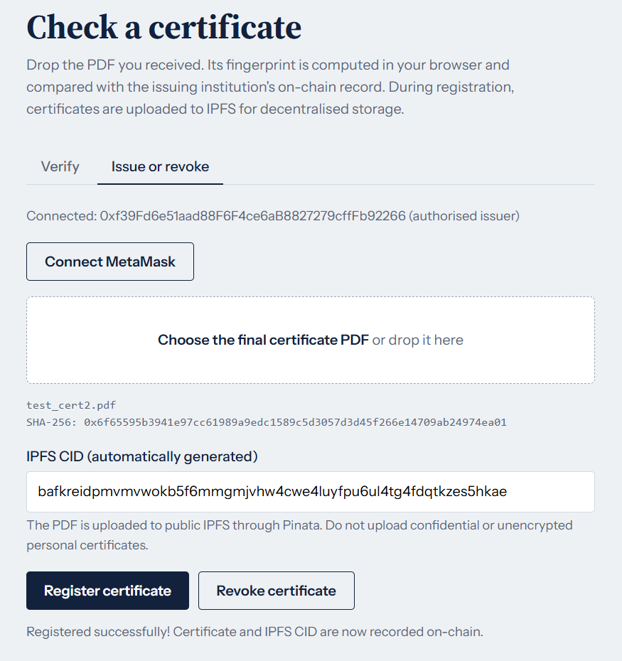
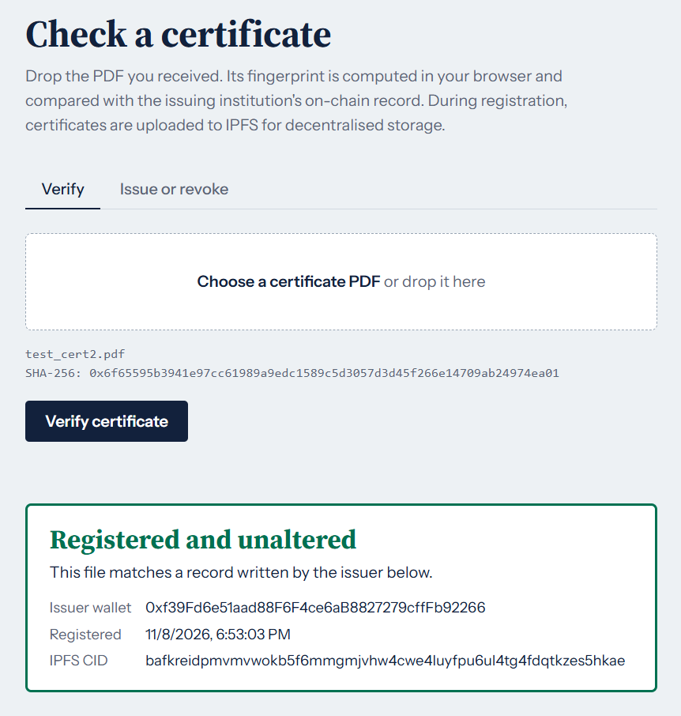
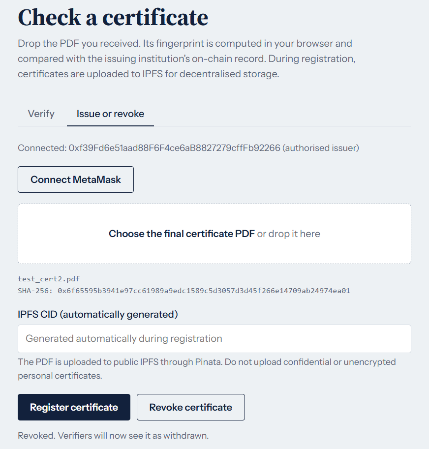
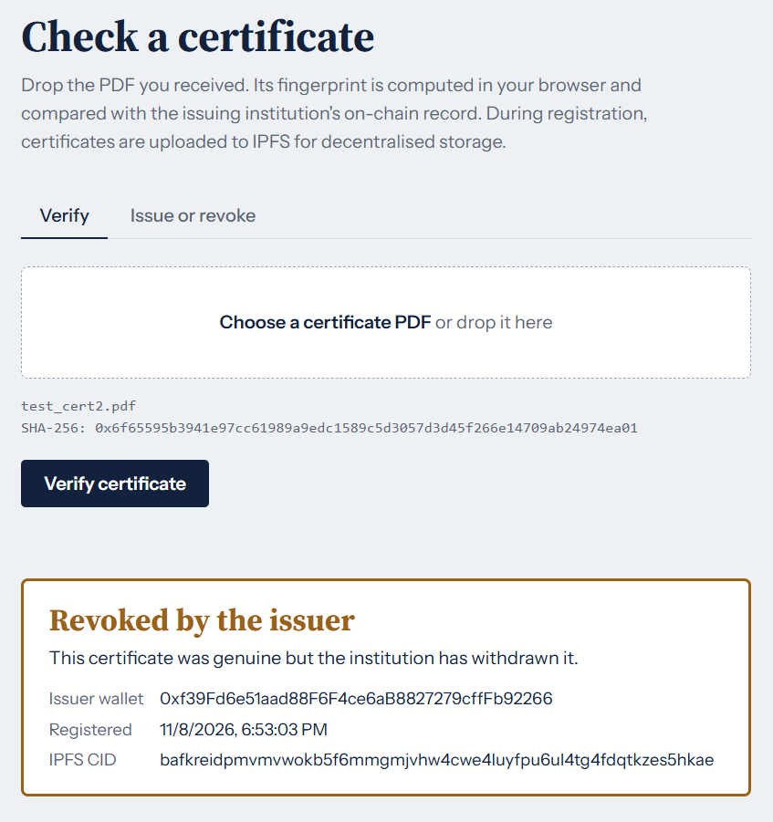

# CertChain 🔗
### Blockchain-Based Educational Certificate Verification

CertChain is a decentralised application for issuing, verifying, and revoking educational certificates using Ethereum smart contracts, SHA-256 hashing, and IPFS.

The application allows institutions to register certificates on-chain while enabling anyone to verify their authenticity using the original PDF.

## Features

- **Certificate Registration:** Register certificates using their SHA-256 fingerprints.
- **Blockchain Verification:** Verify certificates against tamper-resistant Ethereum records.
- **Certificate Revocation:** Allow authorised issuers to revoke previously registered certificates.
- **IPFS Storage:** Automatically upload certificate PDFs to IPFS through Pinata and store their CIDs on-chain.
- **MetaMask Integration:** Connect an authorised wallet to perform blockchain transactions.
- **File Integrity:** Detect modified documents by comparing their SHA-256 fingerprints.

## Screenshots

### 1. Certificate Registration
Upload a PDF, generate its SHA-256 fingerprint, and store its IPFS CID on the blockchain.



### 2. Successful Verification
Verify an original certificate against its blockchain record.



### 3. Certificate Revocation
Authorised issuers can revoke previously registered certificates.



### 4. Revoked Certificate Verification
The system identifies certificates that have been revoked by their issuer.



## Tech Stack

| Component | Technology |
|---|---|
| Smart Contracts | Solidity |
| Blockchain Development | Hardhat |
| Blockchain Interaction | Ethers.js |
| Wallet | MetaMask |
| Backend | Node.js, Express.js |
| Storage | IPFS, Pinata |
| Frontend | HTML, CSS, JavaScript |
| File Integrity | SHA-256 |

## Getting Started

### Prerequisites
- Node.js and npm
- MetaMask browser extension
- Pinata account and API JWT

### Installation

1. Clone the repository:

   ```bash
   git clone <repository-url>
   cd certchain
   ```

2. Install dependencies:

   ```bash
   npm install
   ```

3. Configure the backend environment.

   Create `backend/.env`:

   ```env
   PINATA_JWT=your_pinata_jwt
   PORT=3001
   ```

   Never commit your `.env` file or expose your Pinata JWT.

### Running the Application

Open separate terminals from the project directory.

**Terminal 1 – Start the local blockchain**

```bash
npm run node
```

**Terminal 2 – Deploy the smart contract**

```bash
npm run deploy
```

**Terminal 3 – Start the IPFS backend**

```bash
cd backend
node server.js
```

**Terminal 4 – Start the frontend**

```bash
npm run web
```

Open `http://localhost:3000` in your browser and connect MetaMask to the Hardhat Local network.

Follow the project's deployment configuration if you need to update the contract address in the frontend.

## Testing

Run the smart contract test suite:

```bash
npm test
```

## Security Note

This project is intended for demonstration and educational purposes.

Certificate PDFs uploaded through the current Pinata integration are stored on public IPFS without encryption. Do not upload confidential documents or real personal certificates.

---

**Developed as a blockchain-based certificate verification project using Ethereum and IPFS.**